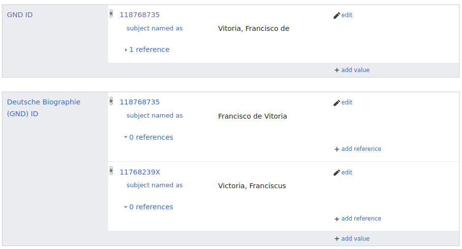
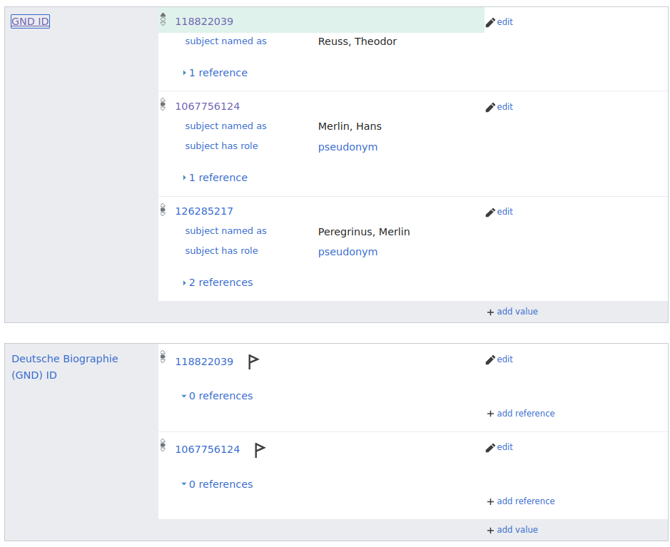
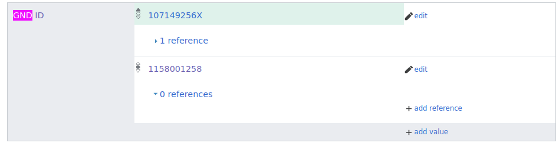
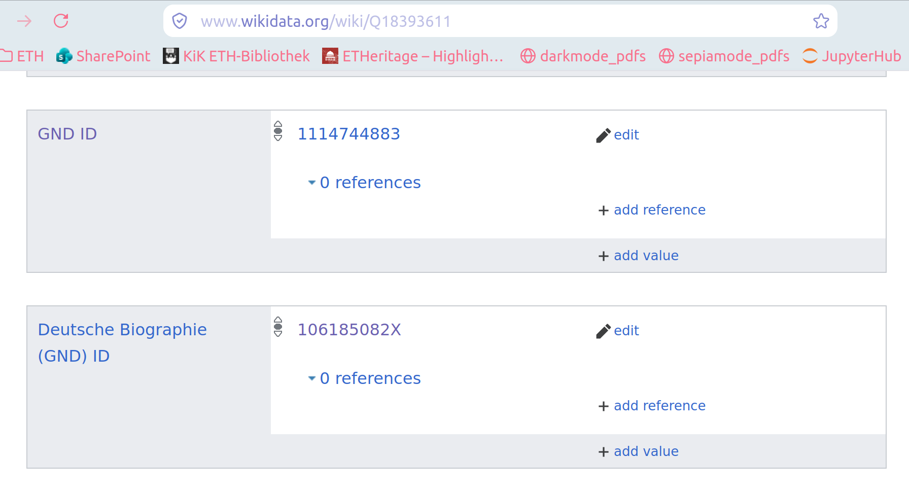
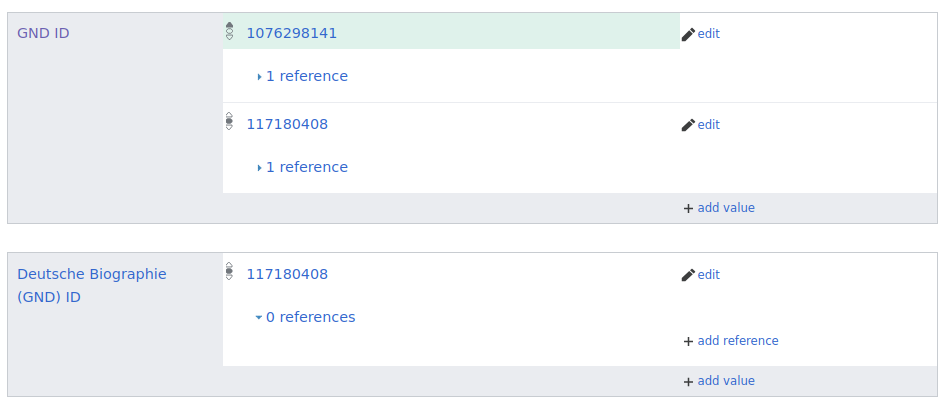

# gnd-wikidata-resolver

Resolve Wikidata Q-IDs to GND IDs, and tell you what to do when an item has more than one.

A single Wikidata item can be linked to several GND IDs. That is not always an error: the GND may have merged records, or the person may have a pseudonym with its own record. This package looks up the GND IDs of an item, resolves outdated ones, and classifies the remaining cases so you know whether the link can be fixed or needs a human.

## Installation

Requires Python 3.10 or newer.

```
pip install git+https://github.com/rashitig/gnd-wikidata-resolver
```

For development:

```
git clone https://github.com/rashitig/gnd-wikidata-resolver
cd gnd-wikidata-resolver
pip install -e .
pytest
```

## Usage

### Q-ID to GND IDs

```python
from gnd_wikidata_resolver import get_gnd_id_by_wikidata_id, classify_item

get_gnd_id_by_wikidata_id("Q1698005")
# {"Q1698005": ["100118623", "129413917"]}
```

`get_gnd_id_by_wikidata_id` returns the current GND IDs of the item (P227 and P7902). Old IDs that were merged in the GND are replaced by their current ID, IDs without a GND record are dropped, and duplicates are removed. The list is empty if the item has no GND ID.

When an item has several IDs, ask for the decision:

```python
decision = classify_item("Q1698005")

decision.case      # "pseudonyms"
decision.gnd_ids   # ["100118623", "129413917"]
decision.label     # label of the Wikidata item
decision.note      # human-readable reason
decision.keep      # GND ID(s) that belong to the item (only for "different_persons")
decision.remove    # GND ID(s) that should be removed (only for "different_persons")
```

Both functions share one cached lookup, so calling them one after the other for the same Q-ID makes no extra requests.

### GND ID to Q-ID

```python
from gnd_wikidata_resolver import get_wikidata_id_by_gnd_id
from gnd_wikidata_resolver.wikidata import get_wikidata_item_properties_by_gnd_id

get_wikidata_id_by_gnd_id("101620017X")
# {"101620017X": ["Q18221845"]}

get_wikidata_item_properties_by_gnd_id("101620017X", label_lang="de")
# all Wikidata properties of the item with this GND ID
```

This function looks up the given GND ID on lobid. It follows possible redirects to the current GND ID and queries Wikidata for the possibly "old" GND ID, and the current one. This covers the case where you are looking for the current GND ID, but the Wikidata item still lists the old one.

### Identify yourself

Wikidata asks API users to send a User-Agent with contact details:

```python
from gnd_wikidata_resolver import set_user_agent

set_user_agent("my-project/1.0 (https://example.org; me@example.org)")
```

## Decisions

`decision.case` is one of the values below. The numbered cases are the situations the package was written for.

| `case` | Meaning | Can it be fixed automatically? |
|---|---|---|
| `ok` | One GND ID, nothing to do | n/a |
| `merged` | Case 0: an old ID was merged in the GND | Yes, use the current ID |
| `pseudonyms` | Case 1: the records refer to each other as pseudonyms | No, both links can be correct |
| `different_persons` | The records describe different people and the item matches exactly one | Yes, see `keep` and `remove` |
| `duplicate` | Case 4: same name and dates, probably duplicate GND records | No, consider reporting to the DNB |
| `unsure` | Case 4: not enough information to decide | No, needs manual research |

Decisions are suggestions. Check them before you edit Wikidata or contact the DNB.

## The cases

### Case 0: Old authority IDs

The GND periodically merges authority records that refer to the same person. A Wikidata item may still reference the old ID.

Example: https://www.wikidata.org/wiki/Q312384



lobid.org redirects an old ID to the current record, so the package requests each ID without following redirects and reads the new ID from the `Location` header.

### Case 1: Pseudonyms

Some people use a pseudonym for their professional life and have a separate GND record for it. Both links can then be correct for the Wikidata item.

Example: https://www.wikidata.org/wiki/Q213855, whose GND IDs are https://d-nb.info/gnd/118822039 and https://d-nb.info/gnd/1067756124



The package reports `pseudonyms` when one DNB record points to the other and mentions a pseudonym. What to do with such an item depends on your use case, so it is never changed automatically.

### Case 2: Incorrect or uncertain linking

Example: https://www.wikidata.org/wiki/Q5460735



The package queries through the `wdt:` prefix, which gives preference to the best-ranked statement as defined by Wikidata.

### Case 3: Different IDs in the two GND properties

Wikidata has two properties for the GND ID, P227 and P7902. If they hold different IDs there is no priority ordering like in Case 2.

Examples: https://www.wikidata.org/wiki/Q18393611 (106185082X is clearly incorrect) and https://www.wikidata.org/wiki/Q94803987



The package returns both IDs and classifies them like any other multiple-ID item. Fixing the item means changing the Wikidata record.

### Case 4: Possibly incorrect GND IDs

The two GND IDs may refer to the same person, but the information is not enough to tell. This needs a closer look at the person or persons in order to consolidate or clearly disambiguate them.

Example: https://www.wikidata.org/wiki/Q72067012



## How the classification works

1. Each GND ID is requested from lobid.org once; redirects mean the record was merged.
2. If one record refers to the other and mentions a pseudonym: `pseudonyms`.
3. If birth or death years differ, the records are scored against the Wikidata item (name, birth year, death year). A clear winner gives `different_persons`, otherwise `unsure`.
4. If all records have the same name and dates: `duplicate`.
5. Anything else: `unsure`.

The pseudonym check looks for the other record's ID and the word "Pseudonym" in the lobid record, and name matching compares name tokens. Both are heuristics to reduce time spent on checking the multiple GND-IDs later on.

## License

See [LICENSE](./LICENSE).